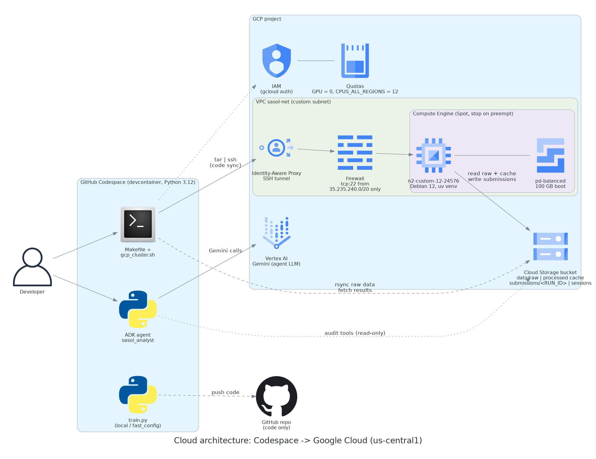
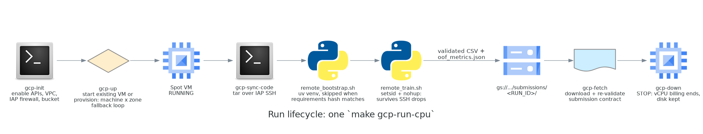
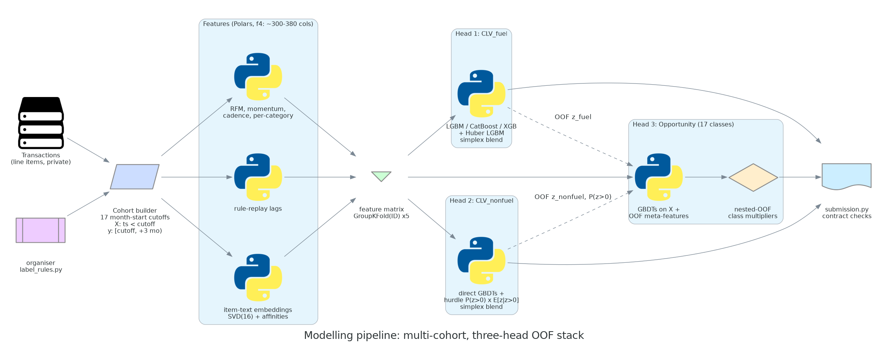

# Sasol Customer Value Recruitment Challenge: project write-up

Author: Zolisa Silolo · October 2026 · Python, Polars, LightGBM/CatBoost/XGBoost, Google Cloud, Google ADK

> Data notice: the competition data is Sasol's intellectual property and is not part of this repository. This includes transactions, test IDs, sample submission, organiser label rules and config, and all submissions and derived caches. Everything here is code, configuration, aggregate metrics and diagrams.

## 1. The challenge

Using historical forecourt and convenience-store transactions, predict for each of 5,488 customers what they will do over the next three calendar months:

| Target | Type | Definition | Metric |
|---|---|---|---|
| `CLV_fuel` | regression | `ln(1 + litres) / 2.3528` | RMSE (weight 0.3) |
| `CLV_nonfuel` | regression | `ln(1 + rand spend) / 2.4201` | RMSE (weight 0.3) |
| `Opportunity` | 17-class classification | Inactivity, Stable, *Existing-category growth: X* or *New category adoption: X*, from deterministic organiser rules | weighted F1 (weight 0.4) |

Internally I minimised `composite_loss = 0.3·RMSE_f + 0.3·RMSE_nf + 0.4·(1 − wF1)`. From two public leaderboard scores I reverse-engineered the leaderboard scale exactly (to 1e-9): `0.3·(1 − RMSE_f/0.74) + 0.3·(1 − RMSE_nf/0.816) + 0.4·wF1`, where higher is better. That let me predict leaderboard movement offline, before spending a submission.

Self-imposed constraints: no AutoML, a fixed global seed (42), reproducible from one `make` target, and runnable on a laptop or in the cloud.

## 2. Architecture

### 2.1 Cloud



- Development ran in a GitHub Codespace (devcontainer). A `Makefile` wraps `scripts/gcp_cluster.sh`, which drives the full Google Cloud lifecycle through `gcloud`. Every step supports `DRY_RUN=1` to print the plan without running it.
- Compute: a Compute Engine Spot VM (`n2-custom-12-24576`, Debian 12) with a 100 GB pd-balanced boot disk. Preemption is set to STOP rather than delete, so a preempted run loses compute but keeps its environment.
- Network security: the VM sits in a dedicated custom-subnet VPC. The only ingress rule is SSH on tcp:22 from Google's IAP range `35.235.240.0/20`, so nothing is exposed to the internet and every SSH session goes through Identity-Aware Proxy.
- Storage: one Cloud Storage bucket with uniform bucket-level access held raw data, the parquet feature cache, per-run submissions (`submissions/<RUN_ID>/`) and session backups. The session-sync script refuses to push if the bucket grants `allUsers` access, and never uploads credential files.
- AI assistant: a Google ADK agent (`agents/sasol_analyst`) running Gemini on Vertex AI. It has tool-grounded functions for dataset overview, bucket status, label-rule inspection, metric inspection and submission auditing. Its prompt forbids answering schema or score questions without calling a tool first.

### 2.2 Run lifecycle



`make gcp-run-cpu` runs end to end:

1. Provision with a machine-type × zone fallback loop. Only capacity and quota errors are retried; any other error fails fast.
2. Sync code as a tar stream over IAP SSH.
3. Bootstrap a `uv` virtualenv. This is skipped when the requirements hash hasn't changed, so restarts take seconds.
4. Train under `setsid nohup`, so the job survives SSH drops while `make gcp-logs` re-attaches.
5. Upload the validated submission and metrics to GCS, download them and re-validate.
6. Stop the VM, which ends vCPU billing.

### 2.3 Modelling pipeline



- Leak-free cohorts. Each cutoff `t` produces one training example per customer: features from rows with `ts < t`, targets from `[t, t + 3 months)`. Labels are generated by calling the organiser's own `label_rules.py`, and a unit test asserts they are byte-identical.
- Validation that matches deployment:
  - Out-of-time (OOT): train on cohorts whose outcome window closes on or before 2025-09-01, with overlapping cohorts purged, and score the 2025-09-01 cohort.
  - Final fit: 5-fold `GroupKFold` on customer ID, so a customer's overlapping cohorts never straddle folds.
- Features (Polars, `f4`):
  - RFM, momentum, cadence and per-category windows from 7 to 180 days.
  - Rule-replay lags: the organiser's label logic applied to past quarters, which gives "what label would this customer have had last quarter?"
  - Spend volatility and growth-hurdle gaps: distance to the R20 and ×1.25 growth thresholds.
  - Sentence-transformer embeddings of unique item texts only (hundreds of strings, not 467k lines), reduced by SVD to 16 dimensions, plus cosine affinity to the 17 class descriptions.
- Three-head OOF stack:
  - Head 1 (fuel): LGBM, CatBoost and XGBoost, plus a Huber LGBM, simplex-blended on OOF.
  - Head 2 (non-fuel): direct GBDTs plus a hurdle model, P(spend > 0) × E[z | z > 0], blended on OOF. Once the data grew to 70k rows, the hurdle model became the largest blend member at about 0.50 weight, up from 0.17.
  - Head 3 (Opportunity): GBDTs on the features plus OOF meta-features from Heads 1–2. Then nested-OOF per-class multipliers in [0.2, 5]^17, with automatic fallback to plain argmax when the multipliers don't help on held-out folds.
- Safety net: `src/submission.py` asserts shape (5488, 4), column names, ID order, no NaNs, CLV ≥ 0 and valid labels before any file is written, and again after download from the cloud.
- Tests: 47 pytest tests run on synthetic data through the real label rules.

## 3. Timeline

| Date | Milestone |
|---|---|
| 8 Oct | Scaffold: multi-task pipeline, Hugging Face representation layer, Colab offloading (later retired in favour of Compute Engine) |
| 15 Oct | ADK analyst agent on Vertex AI Gemini with label-rule and submission-audit tools |
| 15–16 Oct | Rebuilt as a multi-cohort three-head stack. GCP orchestration (VPC, IAP, bucket, Spot VM, detached training), session sync. First full run: 23 min on a 4-core laptop |
| 16 Oct | Hit cloud quota: GPU quota 0 (L4/T4/GPUS_ALL_REGIONS), and `CPUS_ALL_REGIONS = 12` rejected `c2d-highcpu-32` and `n2-highcpu-32` in all four zones. Switched to CPU mode on a custom 12-vCPU N2 |
| 17 Oct | `f4` features (rule-replay lags, growth-hurdle gaps, spend volatility) and an OOT experiment harness |
| 18 Oct | 12 extra month-start cohorts (17 cutoffs, 22,679 → 70,678 training rows), regularised "tuned" and "v2" configs on GCP, decision-layer / hurdle / station-context / survival experiments |
| 19 Oct | Competition closed. Cloud resources torn down, write-up published |

## 4. Results

All numbers come from the run artefacts (`oof_metrics_*.json`). "LB-scale" applies the reverse-engineered leaderboard formula to the OOT metrics, where higher is better.

| Run | Train rows | Features | OOT RMSE fuel | OOT RMSE non-fuel | OOT wF1 | OOT composite ↓ | LB-scale ↑ | Runtime |
|---|---|---|---|---|---|---|---|---|
| fast (5 quarterly cohorts) | 22,679 | 339 | 0.5995 | 0.7441 | 0.5093 | 0.5993 | 0.2871 | 23 min (laptop) |
| fast + f4 features | 22,679 | 382 | 0.5989 | 0.7438 | 0.5181 | 0.5956 | 0.2910 | 24 min (GCP) |
| tuned (17 monthly cohorts) | 70,678 | 314 | 0.5988 | 0.7451 | 0.5211 | 0.5948 | 0.2917 | 34 min (GCP) |
| v2 (deeper trees, Powell multipliers) | 70,678 | 314 | 0.5992 | 0.7452 | 0.5149 | 0.5974 | 0.2891 | 47 min (GCP) |

Grouped 5-fold OOF on the tuned run: RMSE fuel 0.6019, RMSE non-fuel 0.7768, wF1 0.4845, composite 0.6198.

What moved the score:

- Opportunity carried most of the signal. It has the largest weight, and the f4 rule-replay features plus class multipliers lifted OOT wF1 from 0.509 to 0.521. On the tuned run the multipliers alone were worth +0.014 wF1 over argmax.
- More cohorts helped the classifier more than the regressors. Monthly augmentation tripled the rows and improved the single-model harness composite from 0.6041 to 0.6016.
- The hurdle model became the dominant non-fuel member once there was enough data.

What didn't (all within noise across the 2024-12, 2025-06 and 2025-09 OOT cutoffs, so none went into production):

- Hierarchical gating, stacked gate probabilities, prior-shift and recency decay for Opportunity (`scripts/opp_harness.py`).
- Direct vs hurdle vs blended re-tests for both CLV targets (`scripts/reg_harness.py`).
- Station-context features: site momentum, churn, fuel-grade mix (`src/context_features.py`).
- Empirical-Bayes gap-survival churn features (`src/survival_features.py`).
- Recency-weighted cohort decay (0.6 / 0.8).
- v2's deeper trees, which were slightly worse than tuned. Capacity was not the bottleneck.

Final leaderboard position: *(add rank/score here)*

## 5. Engineering lessons

1. Trust out-of-time validation over random CV. The OOF and OOT numbers disagree by about 0.02 composite, and only OOT tracked the leaderboard. Every experiment was judged on several OOT cutoffs before it was allowed into production.
2. Reproduce the label generator, don't approximate it. Importing the organiser's rules and testing for byte-identical labels removed a whole class of silent bugs, and it made "rule-replay" feature engineering possible.
3. Check cloud quotas first. A new project had zero GPUs and a 12-vCPU global cap. The provisioning loop now tells capacity/quota errors (retry the next candidate) apart from real errors (fail fast). With about 5k customers per cohort, CPU training was entirely adequate.
4. Plan for Spot from the start: stop-on-preempt, detached training, hash-skipped bootstrap and per-run GCS prefixes made cheap preemptible compute practical.
5. Keep security on by default: IAP-only SSH with no open ports, a private bucket with uniform access, no credentials in the repo or backups, and `.env` git-ignored.
6. Ground the LLM assistant. The ADK agent was only useful once every factual answer had to come from a tool call against real files and buckets.

## 6. Teardown and data governance

After the competition closed (19 Oct 2026), I deleted these resources:

- the Compute Engine VM and its 100 GB persistent disk
- the GCS bucket, including raw data, feature cache, submissions and session backups
- the dedicated VPC, its subnet and the IAP firewall rule

Afterwards, instance, disk, snapshot and static-IP listings for the project were all empty.

The original development repository stays private. This public repository was created with a fresh git history that contains no competition data, submissions, logs or project identifiers.

## 7. Reproducing

The code runs as-is once the competition files are placed in `data/raw/`. They're available to registered participants from the organiser; see the main [README](../README.md). Diagrams regenerate with:

```bash
pip install diagrams==0.25.1        # requires Graphviz
python docs/diagrams/make_diagrams.py
```
